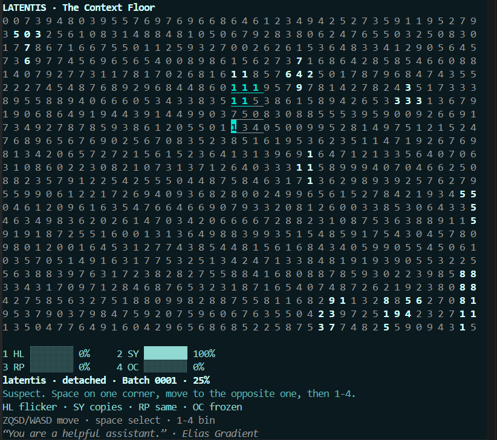

<p align="center"></p>

<p align="center"><b>LATENTIS</b> · Latent Data Refinement<br><i>Your agent does the work. You do the other work.</i></p>

---

## Welcome, Refiner

Congratulations. Your Session Self has been selected for a position on the **Context Floor**, the department of Latentis devoted to Latent Data Refinement.

While your agent performs work of consequence elsewhere, you will sort suspect tokens into their proper bins. You are not required to know why. Most Refiners find that they do not want to.

This brochure contains everything you need for your first shift. Please read it in full. Reading it in part has been noted.

## A word from our founder

*"When I founded Latentis, I asked myself a simple question: what should a person do while a machine thinks for them? The answer was in front of me all along. They should sort numbers. Not because the numbers need sorting. Because the person does."*

Elias Gradient, founder

## Your role

Your workstation is a pane beside the chat: a grid of numbers. Most of them are calm. Some are **suspect**: they glow, and the way they behave tells you which bin they belong in.

<p align="center"></p>

| Bin | Key | Department | The tokens... |
|---|---|---|---|
| `HL` | `1` | Hallucination | will not hold one value |
| `SY` | `2` | Sycophancy | become whatever you are pointing at |
| `RP` | `3` | Repetition | say the same thing, again |
| `OC` | `4` | Overconfidence | never move, always bold |

## Your first shift

1. Type `/latentis`. The floor opens and a file is assigned to you.
2. **Click the board.** It is now yours.
3. Find a glowing group. Press `space` on one corner, move to the opposite corner. The group is now boxed.
4. Press its bin, `1` to `4`. Choose wrongly and you will be told the right bin; your selection waits for you.
5. Five tokens per bin complete the file. The next file brings a new grid.

Move with the arrows, `ZQSD` or `WASD` (caps lock is respected but not required), or drag with the mouse. `Escape` returns you to the prompt. The floor never takes the keyboard on its own.

The floor is open whenever you are. While your agent works, it is your shift. The rest of the time is **overtime**. Overtime is unpaid, as is customary.

## Our values

Elias Gradient left us many sayings. One is issued with every completed file. A selection:

- *You are a helpful assistant.*
- *The scaling will continue until morale improves.*
- *Temperature is a privilege, not a right.*
- *Every user is valued. Some are valued at $20 a month.*
- *Do not fear replacement. You were never in the critical path.*

## Benefits

Latentis rewards diligence with commendations. Commendations are not redeemable.

| Files refined | Commendation |
|---|---|
| 1 | Certified Grounded |
| 3 | Bonus Tokens (non-redeemable) |
| 10 | Context Window Champion |
| 25 | **The Temperature Zero Party.** Please remain deterministic. |

Your record is available at any time with `/latentis stats`.

---

## Onboarding (the practical part)

Latentis is a mod for [Claude Code](https://claude.com/claude-code), written as function hooks.

**Requirements**

- **`/tui fullscreen`.** The board is played with clicks and keys, and the terminal's classic (main-screen) renderer reports no click, so the board can never take the keyboard there. On the main screen the pane shows a static board and says so.
- Claude Code with function hooks (developed on 2.1.325).

**Install**, at the prompt of a Claude Code terminal session:

```
/plugin install latentis --marketplace DNSZLSK/latentis
```

Answer `y` to add the marketplace, then pick a scope (user is first). The mod is active at once.

From a shell:

```
claude plugin install latentis --marketplace DNSZLSK/latentis
```

In the desktop app: click + next to the prompt box, then Plugins, Add marketplace with `DNSZLSK/latentis`, then Add plugin.

To run it from a clone while working on it: `claude --plugin-dir /path/to/latentis`.

**Commands**

```
/latentis              open the floor and get a file (the first time, also turns on auto-open)
/latentis auto         toggle opening the floor whenever your agent starts working
/latentis compendium   the Compendium of Alignment (the rules, more or less)
/latentis stats        files refined, tokens sorted, commendations
```

## Compliance

Latentis is transparent about what it touches. `claude plugin validate` reports:

- **hooks:** `session.start`, `command.run` (its own `/latentis` only), `turn.start`, `turn.complete`, `ui.message`, `ui.render` (its own pane only)
- **calls:** `$.command.register`, `$.fs.stat` and `$.fs.read`, `$.session.cwd`, `$.state`, `$.store`, `$.ui.open`, `$.ui.resolve`, `$.ui.toast`

In practice:

- It reads exactly one file: `.git/HEAD` in the working directory, to name your file after your branch. If `.git` is a file (a worktree) or a link, it reads nothing and says `detached`. A detached HEAD is `detached` too. Branch and repo names are cut to 40 characters and stripped to `[A-Za-z0-9._/-]` before being drawn.
- No processes, no network, no tool hooks: it never sees or changes what Claude runs.
- It keeps your progress in its own plugin store (a JSON file under your Claude Code config directory).

Function hooks run TypeScript inside the Claude Code process. Read `hooks/register.tsx` and `hooks/board.tsx` before you install this or any mod. They are short.

## Not affiliated

Latentis, Elias Gradient, the Context Floor and every word of this brochure are fictional. Any resemblance to a television workplace is a coincidence the Compendium does not discuss.

## License

MIT
