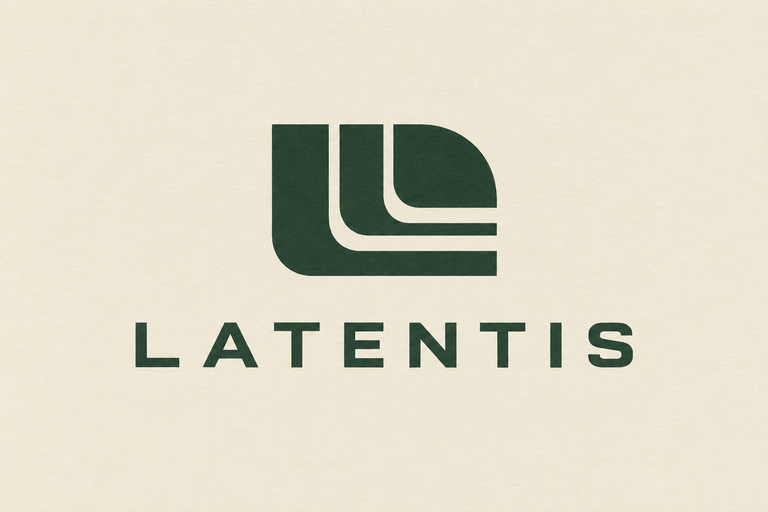

<p align="center"></p>

# Latentis

**Latent Data Refinement.** While your agent does work of consequence, your Session Self sorts suspect tokens into bins on the Context Floor. You are not required to know why.

A Claude Code mod (function hooks): a pane beside the chat with a grid of numbers. Some of the numbers are suspect: they glow, and how they behave tells you their bin:

| Bin | Name | They... |
|---|---|---|
| `HL` | Hallucination | will not hold one value |
| `SY` | Sycophancy | become whatever you are pointing at |
| `RP` | Repetition | say the same thing, again |
| `OC` | Overconfidence | never move, always bold |

Click the board, box a glowing group (`space` on one corner, move to the opposite one), press its bin (`1`-`4`). The pane keeps the rules in one line (`HL flicker · SY copies · RP same · OC frozen`), and a wrong bin tells you the right one. Five tokens per bin complete the file, and the next file brings a new grid. Your agent finishing its turn ends your shift, unless you are still at the board: then it is overtime, and the floor stays live until you leave it (Escape, or back to the prompt). It pauses until your agent leaves again. A file can span as many turns as it takes.

## Requirements

- **`/tui fullscreen`.** The board is played with clicks and keys, and the terminal's classic (main-screen) renderer reports no click, so the board can never take the keyboard there. On the main screen the pane shows a static board and says so.
- Claude Code with function hooks (developed on 2.1.325).

## Install

At the prompt of a Claude Code terminal session:

```
/plugin install latentis --marketplace DNSZLSK/latentis
```

Answer `y` to add the marketplace, then pick a scope (user is first). The mod is active at once.

From a shell:

```
claude plugin install latentis --marketplace DNSZLSK/latentis
```

In the desktop app: click + next to the prompt box, then Plugins, Add marketplace with `DNSZLSK/latentis`, then Add plugin.

To run it from a clone while working on it: `claude --plugin-dir /path/to/latentis`.

## Use

```
/latentis              open the floor (the first time, also turns on auto-open)
/latentis auto         toggle opening the floor whenever your agent starts working
/latentis compendium   the Compendium of Alignment (the rules, more or less)
/latentis stats        files refined, tokens sorted, commendations
```

On the board (click it first, during your agent's turn): arrows, `ZQSD` (AZERTY) or `WASD` (QWERTY) move, either case, `space` anchors a selection (or drag with the mouse), `1` HL · `2` SY · `3` RP · `4` OC. Escape hands the keyboard back to the prompt. The floor never takes the keyboard on its own.

Commendations are awarded for diligence. They are not redeemable. Twenty-five files earn the Temperature Zero Party.

## What it touches

`claude plugin validate` reports for this mod:

- **hooks:** `session.start`, `command.run` (its own `/latentis` only), `turn.start`, `turn.complete`, `ui.message`, `ui.render` (its own pane only)
- **calls:** `$.command.register`, `$.fs.stat` and `$.fs.read`, `$.session.cwd`, `$.state`, `$.store`, `$.ui.open`, `$.ui.resolve`, `$.ui.toast`

What that means in practice:

- It reads exactly one file: `.git/HEAD` in the working directory, to name the file after your branch. If `.git` is a file (a worktree) or a link, it reads nothing and says `detached`. A detached HEAD is `detached` too. Branch and repo names are cut to 40 characters and stripped to `[A-Za-z0-9._/-]` before being drawn.
- No processes, no network, no tool hooks: it never sees or changes what Claude runs.
- It keeps its progress in its own plugin store (a JSON file under your Claude Code config directory).

Function hooks run TypeScript inside the Claude Code process. Read `hooks/register.tsx` and `hooks/board.tsx` before you install this or any mod. They are short.

## Not affiliated

Latentis, Elias Gradient and the Context Floor are fictional. Any resemblance to a television workplace is a coincidence the Compendium does not discuss.

## License

MIT
